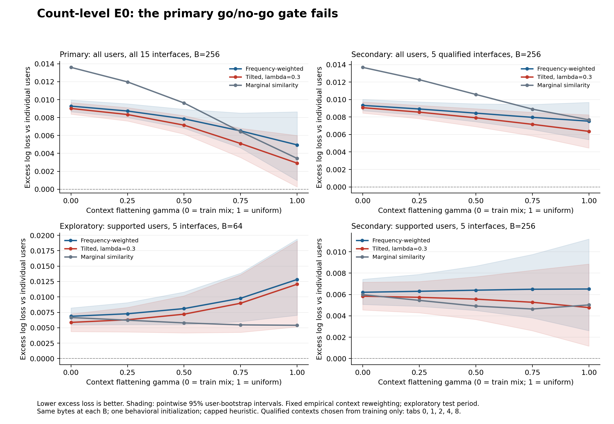

# Count-level E0: executed go/no-go experiment

**Decision: NO-GO for escalating the current KuaiRand count-sharing setup into a full experiment campaign.**

The fixed primary gate fails: frequency-weighted sharing damage decreases under interface flattening, and the tilted objective has no established advantage in the growth contrast. This is an exploratory diagnostic, not a universal rejection of context-aware compression.

## What was executed

- Real, previously audited KuaiRand-Pure data; existing duplicate quarantine, UTC chronology and native long_view label unchanged.
- Training: 1,051,988 interactions; validation: 59,072; standard evaluation: 278,684. Random-exposure outcomes were not used in this E0 evaluation.
- 27 grouped count predictors: budgets 64/256/1024 times random (3 seeds), marginal similarity, frequency-weighted behavioral grouping, and tilted grouping at lambda 0.1/0.3/1/3.
- Three references: individual-user/context counts, video/context counts, and global rate. The individual reference exactly reproduces the previous probe predictions.
- All-user cohort: 25,748 evaluation users, 278,684 events. Supported cohort: 4,211 observed evaluation users, 69,792 events, selected by >=10 train events in >=2 interfaces; 4,229 training users qualify overall.
- Four context sweeps, five gamma values each, both cohorts; 1,200 saved model/cohort/sweep rows. Per-user/context loss sums and counts are saved so aggregation is auditable.
- No neural training, GraphHash/CCE/BACO execution, Kaggle operation, NVIDIA inference, new download, package installation, or external write in this spike.

## Frozen mathematical contract

For each train user and interface, estimate r_us=(positive_us+10*p_context_s)/(n_us+10). Replace r_us by p_context_s if n_us<10 for the grouping profile. This equals shrinking the residual logit to zero; it is not deconfounded preference estimation.

Let m_gs be the arithmetic mean of r_us within group g, and c_gs the mean KL(Bern(r_us)||Bern(m_gs)) across its users. The frequency objective is sum_g |g|/N * sum_s p_train(s)c_gs. The tilted objective is sum_g |g|/N * lambda*log(sum_s p_train(s)*exp(c_gs/lambda)). Users, not training events, receive equal weight in this grouping objective.

Frequency and tilted variants start from the identical seed-11 balanced random partition, use the same nonempty-group/maximum-size constraint, and use the same capped generalized Lloyd heuristic. Every accepted step reduces its exact recorded objective. Iterations are capped at 12; these are not globally optimal solutions and several fits hit the cap.

After grouping, aggregate the actual train positive/negative counts by group and interface and smooth with alpha=10. Predict sigmoid(logit(video/interface probability)+logit(group/interface probability)-logit(interface probability)). All grouped and individual effects have fixed weight 1. No grouping hyperparameter was selected on this E0 test.

The group table is fitted from actual counts, including low-support cells. The support threshold affects grouping features, not which labels are discarded. Unseen users receive zero personal residual.

All grouped methods at a given B store the same dense B*15 float32 probabilities and the same fixed-length int16 mapping; common item/context/global arrays are identical. Bytes refer to allocated numerical inference arrays, excluding archive/container overhead and training buffers. Reference byte counts include the common bundle even when a control does not use every member.

| Groups B | Grouped predictor array bytes |
|---|---:|
| 64 | 513,454 |
| 256 | 524,974 |
| 1024 | 571,054 |

## Primary observed result

The primary comparison was fixed before fitting: B=256, lambda=0.3, all users, all-context flattening. Define Delta(gamma)=loss(grouped,q_gamma)-loss(individual,q_gamma), with q_gamma(s) proportional to p_train(s)^(1-gamma). The underlying test records within each interface remain fixed.

| Gamma | Frequency-weighted sharing penalty | Tilted sharing penalty |
|---:|---:|---:|
| 0 | 0.009275 | 0.009012 |
| 0.25 | 0.008727 | 0.008336 |
| 0.5 | 0.007857 | 0.007149 |
| 0.75 | 0.006508 | 0.005100 |
| 1 | 0.004946 | 0.002907 |

Frequency penalty change, gamma 0 to 1: **-0.004330**, pointwise user-bootstrap 95% interval [-0.008208, -0.000784]. The expected increase is absent in this primary setup; the estimated change is negative.

Frequency-minus-tilted penalty growth: **0.001776**, interval [-0.001595, 0.004743]. This interval includes zero, so a tilted robustness advantage is not established.

Tilted-minus-frequency loss at gamma=0: **-0.000263**, interval [-0.000547, 0.000036].

The three fixed primary conditions use Bonferroni-adjusted one-sided bootstrap bounds at family alpha .05. Ordinary-mixture noninferiority uses an analyst-chosen margin of .001 log loss; failing to reject harm is not treated as proof of equivalence.

| Primary condition | Outcome |
|---|---|
| Frequency sharing penalty grows | FAIL |
| Tilted objective reduces that growth | FAIL |
| Tilted ordinary-mixture loss is within the .001 margin | PASS |
| Combined gate | NO-GO |

These intervals condition on the models, users and observed period. They are not simultaneous bands over gamma or a temporal-generalization guarantee.

## Narrower results and counterevidence

- At B=64 on supported users and the five train-qualified interfaces, the frequency penalty increases by 0.005973; its pointwise 95% interval is [0.000414, 0.012077]. This is a narrower exploratory signal, not a confirmation selected independently of the grid.
- In that same comparison, the lambda=.3 tilted penalty grows by 0.006192, slightly more. Its growth advantage is -0.000219 with interval [-0.003296, 0.002485]. The proposed remedy is not established there.
- Across 96 budget/lambda/cohort/sweep diagnostics, none passes all three conditions. This does not validate a multiplicity-free grid search or establish that all alternative methods fail.
- Supported-user all-15-interface intervals retain only 545/1000 bootstrap resamples because some rare interfaces disappear when users are resampled. They are conditional-on-presence summaries and are not dependable nominal-coverage intervals. The qualified-context analyses retain all 1000 resamples.

## Observed-mixture reference table

This table uses the actual standard-test mix. Gamma=0 in the sweep uses the training mix; those losses differ by definition.

| Predictor | Observed standard-test log loss |
|---|---:|
| ungrouped | 0.550850 |
| item_only | 0.570253 |
| marginal_B256 | 0.565030 |
| frequency_B256 | 0.560312 |
| tilted_B256_L0.3 | 0.560025 |

## Requested interface frequencies

Percentages below use each cleaned split as the denominator. Tab IDs are retained; no unsupported semantic interface names are invented.

| Tab | Train rows | Train % | Standard test % | Random test % | Users with >=10 train events in tab | Qualified |
|---:|---:|---:|---:|---:|---:|---|
| 0 | 142,440 | 13.5401 | 9.9227 | 0.0000 | 3619 | True |
| 1 | 792,189 | 75.3040 | 79.3440 | 99.3243 | 18088 | True |
| 2 | 37,613 | 3.5754 | 3.2348 | 0.0644 | 916 | True |
| 3 | 3,480 | 0.3308 | 0.1564 | 0.0000 | 1 | False |
| 4 | 71,638 | 6.8098 | 6.2583 | 0.0000 | 2142 | True |
| 5 | 88 | 0.0084 | 0.0075 | 0.0000 | 0 | False |
| 6 | 257 | 0.0244 | 0.0517 | 0.0000 | 0 | False |
| 7 | 294 | 0.0279 | 0.0610 | 0.0000 | 5 | False |
| 8 | 2,312 | 0.2198 | 0.4833 | 0.0000 | 38 | True |
| 9 | 223 | 0.0212 | 0.0689 | 0.0000 | 5 | False |
| 10 | 67 | 0.0064 | 0.0258 | 0.0000 | 1 | False |
| 11 | 374 | 0.0356 | 0.1102 | 0.5679 | 8 | False |
| 12 | 746 | 0.0709 | 0.2264 | 0.0000 | 13 | False |
| 13 | 257 | 0.0244 | 0.0416 | 0.0000 | 6 | False |
| 14 | 10 | 0.0010 | 0.0072 | 0.0434 | 0 | False |

The literal rarest target is tab 14: only 10 train events and 20 standard-test events, with no train user reaching the per-context threshold. It supplies no supported per-user grouping-profile variation at the chosen threshold. The secondary rarest qualified target is tab 8.

## Corrections to the supplied interpretation

- Differences between separately fitted count models do not form a decomposition of intrinsic user information. The proposed 25% contextual-signal calculation is not established.
- Near-equality between one random-bucket predictor and item-only prediction does not identify the budgets at which behavioral grouping must work.
- Shrinking low-support profiles to zero reduces noisy differences but can also erase real differences. It does not guarantee that false disagreement disappears.
- The random-exposure reversal remains unexplained. Calibration and item exposure changes are plausible mechanisms; moving the result to an appendix does not establish its cause. The optional recalibration check was not run, and even a successful recalibration would not uniquely identify the cause.
- The exponential tilted objective is only a candidate here. This run establishes neither algorithmic novelty nor superiority to closest published embedding methods.

## What the decision permits

Stop escalation to a three-day neural campaign under the current broad thesis. A future experiment needs a justified supported-context mechanism, a grouping objective aligned to that estimand, optimizer/convergence evidence, and independent confirmation data. Neither retuning on this test nor changing the headline to an attractive secondary slice makes the present result confirmatory.

The narrow supported-user B=64 signal may motivate a bounded follow-up, but the tilted method does not currently close that gap. Switching datasets would be a new test, not a demonstrated repair. No new dataset or neural campaign was run.

## Verification, runtime and reproducibility

- Independent verification: independent_artifact_checks_passed; all 30 saved predictors replayed; 60 raw metric rows and 1,200 sweep rows/intervals checked; 300 bootstrap context vectors independently replayed.
- The individual reference matches the previous probe predictions exactly; grouped count tables and group capacities were independently reconstructed from train records.
- The original label/documentation mismatch remains unresolved. Artifact verification does not turn the labels into duration-rule-validated ground truth.
- Successful fitting: 35.06 CPU seconds; evaluation/bootstrap: 7.25; independent verification: 5.50. These exclude coding, inspection, plotting and earlier setup.
- Existing NumPy and Matplotlib used; no installs or upgrades. Sonatype Guide connector is unavailable, so its component check could not be completed; no dependency-safety claim is made.
- Reproduction: run `python -m unittest -v test_e0_math`; `python verify_e0.py` verifies the existing run. Fresh preparation/fitting/evaluation requires a new output directory because scripts refuse to overwrite frozen receipts.

Artifacts: protocol.json, fit_manifest.json, results.json, gates.json, context_frequencies.csv, raw_metrics.csv, per_context_metrics.csv, sweep_metrics.csv, predictions_standard.npz, per_user_context_loss_sums.npz, bootstrap_context_deltas.npz, verification.json, models/, figures/.

