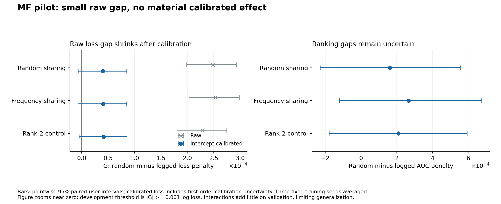

# Executed MF exposure-policy pilot

**Verdict: no material calibration-robust gap established in this restricted pilot; do not launch the full compression benchmark from this result.**

The broader exposure-evaluation hypothesis remains open. The selected models have very weak latent-interaction gains beyond their bias terms. Therefore this is a mathematically defined, verified diagnostic, not a decisive test across representative embedding-compression systems.

## Mathematical objects and identification boundary

See MATHEMATICAL_FOUNDATION.md for the full pre-fit derivations, assumptions, standardized risk, Bernoulli KL identity, calibration optimization, influence-function correction, and ranking estimand. The uniform validation-only regularization amendment is recorded separately in protocol_amendment_01.json; the original specification and fits are preserved.

For policy P, Delta_P(m)=R_P(m)-R_P(full), with the same uniform user weighting under both policies. G(m)=Delta_random(m)-Delta_logged(m). A negative G means a smaller measured penalty under random exposure for this declared target; a positive G means a larger one. Neither sign establishes imitation of an old recommender or intrinsic preference loss.

Under conditional-outcome invariance and support, G=E_logged[(density_ratio-1)*conditional_excess_risk]. Without invariance there is an additional conditional-response/state term. No density ratio or propensity is estimated in this pilot. A class-prior correction does not identify these causal terms.

For logistic risk, conditional excess risk is KL(eta||prediction_m)-KL(eta||prediction_full). The full fitted model is not a Bayes oracle, so compression penalties can be negative. A ratio of penalties can consequently reverse its interpretation.

A post-evaluation second-order audit additionally verifies 0 <= loss_m-loss_full-(p_full-y)*(z_m-z_full) <= (z_m-z_full)^2/8 pointwise. This is an elementary deterministic curvature bound, not a confidence interval or new theorem. See SECOND_ORDER_RISK_AUDIT.md, risk_certificates.csv and risk_certificate_verification.json.

## Data and fitted comparisons

- Real previously audited KuaiRand-Pure data, native long_view, duplicate-key quarantine and chronological UTC splits preserved. The native duration-rule mismatch remains unresolved.
- Training and validation restricted to tab=1: 792,189 train events, 24,837 users, 7,214 items, and 44,362 warm-ID validation events.
- Common target support: 22,859 users and 5,692 items. A fixed label-independent hash assigns 2,253 users to calibration and 20,606 to evaluation.
- Evaluation interactions: 188,362 standard and 722,167 random. Calibration interactions: 20,828 standard and 80,537 random. Each user receives equal evaluation weight despite different interaction counts.
- The common both-class AUC cohort contains 9,749 evaluation users. This outcome-defined subgroup is reported separately from the all-user loss target.
- Model: global + individual user bias + item bias + user/item interaction dot product. Only the user interaction-factor table is shared. Bias terms remain individual; item table sizes are identical but are fitted separately per model.
- Four conditions and three seeds: full d=16 user factors; random sharing into 3,107 rows; frequency sharing at the same rows; rank-2 individual-user factorization as capacity control.
- The dense control has 49,706 interaction parameters and shared tables 49,712, a 24-byte difference. Actual inference arrays including lookup/mapping: full 2,418,288 bytes; random/frequency 1,027,568; rank2 1,027,544. User interaction factors are reduced by about8x; total stored inference arrays by about2.35x. These are different compression ratios.

## Prospective protocol amendment and model quality

The original 12 fits used a fixed factor penalty .0001. Their latent interactions overfit: the first full seed training BCE fell from .6325 to .3548 while validation loss rose from .6129 to .8452. Removing interactions from the selected full checkpoints improved validation. A synthetic opposite-user-ranking check passed; that is implementation sanity only.

Before new policy evaluation, one common validation-only repair expanded the factor-penalty grid to [.0001,.16,1.6], with all other settings unchanged and equal allowance for all methods. Original fits were retained. This produced 36 total fits and 12 selected models, all selecting1.6. No additional tuning was performed after the policy results.

Strong regularization improves validation but leaves small interaction contributions. Across full seeds, the validation loss benefit over zero-interaction ablation is about0.000033-0.000058; AUC improvement does not have the same sign in every seed. This limits how informative the current comparison is about substantial personalized ranking structure. It is not evidence that all MF systems lack such structure.

## Main observed policy gaps

Values are the mean of three fixed training seeds. Intervals resample common users, paired across policies and models. Calibrated intervals include first-order nuisance-intercept estimation uncertainty from disjoint calibration users. They condition on training/model selection and the observed period.

| Method | Raw G | Raw 95% interval | Calibrated G | Calibrated 95% interval |
|---|---:|---|---:|---|
| random | 0.00024768 | [0.00019887, 0.00029296] | 0.00004049 | [-0.00000656, 0.00008520] |
| frequency | 0.00025248 | [0.00020306, 0.00029827] | 0.00004063 | [-0.00000689, 0.00008437] |
| rank2 | 0.00022863 | [0.00018018, 0.00027447] | 0.00004173 | [-0.00000467, 0.00008591] |

The raw gap is small and positive, not the proposed overstatement direction. It becomes much smaller after policy-specific intercept calibration. Every calibrated interval includes zero, and the effects are far below the .001 development threshold. The family-adjusted99% intervals also include zero.

These numerical changes are consistent with calibration sensitivity in these models; they do not prove a unique cause of the earlier count-model reversal. The models, cohorts and individual-bias treatment differ from that earlier probe.

## Ratio failure illustrated by the actual pilot

Random sharing has raw Delta_logged=-0.00001997 and Delta_random=+0.00022771. Their ratio is negative and hence <1, although the measured penalty is larger under random exposure. The supplied R<1 rule would therefore give a misleading directional interpretation in this case. G correctly reports +0.00024768. Absolute penalties and denominator sign must accompany any ratio.

## Ranking and capacity controls

| Method | AUC penalty gap | Pointwise 95% interval |
|---|---:|---|
| random | 0.00016186 | [-0.00022807, 0.00055474] |
| frequency | 0.00026651 | [-0.00012080, 0.00067490] |
| rank2 | 0.00020961 | [-0.00017856, 0.00059366] |

All AUC-gap intervals include zero. An intercept leaves each user ranking unchanged. This is ranking among labeled exposed examples, not a catalogue-wide relevance estimate.

The calibrated G differences between sharing and the rank2 control are around -0.0000012 (random) and -0.0000011 (frequency), both with intervals including zero. No sharing-specific distinction is established beyond this capacity control.

## Calibration scale and uncertainty checks

The full model random-population macro log loss falls from0.517458 to0.274512 after an intercept around-2.03484; standard loss changes from0.603035 to0.602389 after an intercept around-.06374. Cross-policy absolute losses concern different response distributions and must not be interpreted as direct policy utility comparisons.

- First-order calibration bootstrap correction was checked against exact recalibration on ten predetermined draws. Maximum absolute contrast discrepancy: 0.0000042458; guard .0005 passed.
- The spot check does not establish exact finite-sample CI coverage. User sampling, model selection and temporal generalization remain assumptions/limits.

## Decision

- Neither random nor frequency sharing passes the material calibration-robust policy-gap flag.
- The full-reference interaction-quality guard also fails because validation AUC gain does not repeat across all seeds.
- Do not claim that logged evaluation overstates embedding-compression damage, that randomized exposure reveals intrinsic preferences, or that the hypothesis is universally false.
- Do not launch the proposed multi-dataset/multi-backbone/IPS grid from this evidence. A useful next prerequisite, if continuing this question, is a setting with measurable interaction signal and a controlled fixed-response exposure comparison, such as a properly separated KuaiRec matrix experiment. That experiment has not been run or downloaded here.
- Novelty remains unresolved; the elementary risk identities and calibration math are methodological grounding, not an original theoretical contribution. UnKD, CLAX and KuaiRec remain material neighboring precedents.

## Verification and resources

Independent status: independent_artifact_checks_passed. Replayed 12 selected models across48 score vectors, recomputed48 raw/calibrated risks, brute-force checked2,424 individual AUCs, replayed18 paired loss-bootstrap vectors, and checked240 exact recalibration root equations. Equal validation-grid selection and source/fit/evaluation hashes were verified.

Successful fitting across36 trials: 86.18s; evaluation/calibration/bootstrap: 19.42s; independent verification: 17.49s. These exclude implementation, inspection and report rendering.

All execution was local CPU. No Kaggle/GPU job, NVIDIA inference, dataset download, package installation or external write occurred. Existing PyTorch2.13.0+cpu, NumPy2.2.6 and Matplotlib were reused. Sonatype Guide was unavailable, so no component-safety check is claimed.

Commands: python -m unittest discover -v; python verify_pilot.py; python risk_certificate_audit.py. Frozen fitting/evaluation stages refuse overwrite. Saved arrays, models, risk summaries, bootstrap effects, source checksums and protocol amendment support replay.

## Primary references

- Schnabel et al., Recommendations as Treatments (ICML2016): https://proceedings.mlr.press/v48/schnabel16.html
- Gao et al., KuaiRand (CIKM2022): https://arxiv.org/abs/2208.08696
- The targeted compression/exposure literature assessment remains in D:/web_2/research/2026-10-15-webconf/EXPOSURE_COMPRESSION_PROPOSAL_REVIEW.md.

