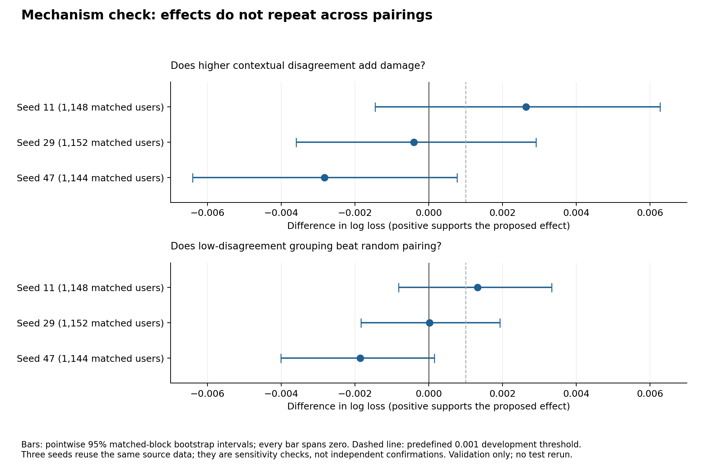

# Bounded mechanism check: executed decision

**Decision: CLOSE THE CURRENT COMPRESSION PROPOSAL; PIVOT.**

The fixed primary gate fails. Contextual disagreement selected in training half A does not have established repeatability in disjoint half B; the validation sharing contrast changes sign across pairing seeds. This closes the current count-sharing/rare-context/tilted proposal under the agreed stopping rule. It does not establish a universal impossibility result about context-aware compression.

## Question and contract

> When users have similar overall behavior and training activity, but different response patterns across interfaces, does forcing them to share count parameters cause extra held-out prediction damage?

- Real KuaiRand-Pure data from the already audited cache, unchanged UTC chronology, duplicate quarantine and native long_view labels.
- Only training and validation splits were accessed by this diagnostic. Standard/random test outcomes were not re-evaluated. Both train and validation had prior development use; this is exploratory evidence.
- Choose the interface pair with the largest number of training users having >=20 events in both, without using outcomes for pair selection. Interfaces 0 and 1 were selected, with 1,284 users before halving.
- Randomly partition train records into disjoint A/B halves with seed 20261016. Each eligible user must retain >=8 records in each chosen interface in each half. A defines profiles and pairings; B fits models and checks profile repeatability. Random partitions do not establish statistical independence for correlated behavior.
- Form four-user blocks with pairwise-caliper controls on A overall logit, A mean interface logit, and full-train activity in both interfaces. Maximum logit ranges .5; maximum context-specific activity ratio 2. Match greedily under three seeds, without validation labels.
- Enumerate all three perfect two-user pairings in each block. Choose low/high disagreement from A only. Neutral is expected loss over the three equally probable pairing outcomes, not prediction averaging.
- All shared models use two users per group, the same dense 15-context table and fixed-length mapping, identical alpha=10 and residual weight=1, and common B video/interface tables. This isolates a modest sharing intervention, not a severe compression regime.
- Evaluate the same matched validation events for each strategy within a seed. Primary metric: per-event binary log loss. Also save equal-context loss, individual-user reference, matched-block bootstrap and user-bootstrap sensitivity.
- A within-block weighted regression controls marginal-rate difference, overall-rate difference, activity mismatch, mean activity, mean marginal component and A item-exposure overlap. This describes adjusted association; it does not identify intrinsic preferences or remove all exposure confounding.

Training users eligible after the A/B support requirements: **1,226**.

## Measured sharing contrasts

Positive high-minus-low supports extra damage from contextual disagreement. Positive neutral-minus-low supports a useful low-disagreement pairing rule. The rows use slightly different training-matched cohorts; comparisons are paired within a row, not between row loss levels.

| Pairing seed | Matched users | Validation events | High minus low loss | 95% block interval | Neutral minus low loss | 95% block interval |
|---:|---:|---:|---:|---|---:|---|
| 11 | 1,148 | 5,287 | 0.002634 | [-0.001455, 0.006267] | 0.001326 | [-0.000820, 0.003331] |
| 29 | 1,152 | 5,346 | -0.000407 | [-0.003592, 0.002909] | 0.000019 | [-0.001833, 0.001926] |
| 47 | 1,144 | 5,341 | -0.002824 | [-0.006404, 0.000764] | -0.001862 | [-0.004008, 0.000152] |

Every sharing-contrast interval above spans zero. The high-minus-low point estimate reverses sign in two of three seeds. The low-disagreement rule has no established gain over neutral pairing.

## Does the selected contextual difference repeat?

Contextual contrast is the difference between the two smoothed interface logits. Pair disagreement is its squared difference between paired users. Low/high selection uses A only; the next table measures high-minus-low disagreement using B.

| Seed | A high-minus-low disagreement | B high-minus-low disagreement | B 95% block interval |
|---:|---:|---:|---|
| 11 | 0.399447 | 0.049634 | [-0.111793, 0.220008] |
| 29 | 0.379392 | 0.108716 | [-0.066084, 0.261841] |
| 47 | 0.359640 | 0.031758 | [-0.119152, 0.185598] |

B point differences are positive but all B intervals include zero. The large A separation was the criterion used to choose the pairings; its size cannot be treated as independent evidence. Failure to establish B repeatability does not prove that user differences are absent.

## Adjusted association and fixed gate

| Seed | Adjusted contextual-disagreement coefficient, per feature SD | 95% block interval |
|---:|---:|---|
| 11 | 0.003257 | [0.000788, 0.005886] |
| 29 | -0.000797 | [-0.003822, 0.001991] |
| 47 | 0.000600 | [-0.002518, 0.003369] |

The primary seed has a positive adjusted association, but that result does not repeat across the other pairings. It does not override the failed reliability and sharing-intervention checks.

The four effects use Bonferroni-adjusted one-sided bounds at family alpha .05. A .001 log-loss minimum effect is an analyst-chosen development threshold, not a proven practical-importance boundary.

| Predeclared gate condition | Result |
|---|---|
| adequate_support | PASS |
| B_repeatability | FAIL |
| extra_sharing_damage | FAIL |
| useful_grouping | FAIL |
| adjusted_association | PASS |
| direction_repeats_at_least_two_seeds | FAIL |

Combined gate: **NO-GO**.

## Optimization sensitivity of the previous prototype

- Extended the previous full-train clustering heuristic to at most 100 rounds for B=64/256, frequency/tilted lambda=.3, three common initializations: 12 fits and 24 saved round-12/final model snapshots.
- All stopped because the heuristic found no accepted proposal, after 10–69 accepted rounds; none reached the 100-round limit. This is heuristic stalling, not certified optimality.
- Several previous 12-round fits were unfinished. Continuing changed validation loss in both directions; improving the grouping objective does not guarantee better prediction.
- The frequency/tilted validation ordering also changes across initializations. This does not establish a stable new-method improvement.
- The four shared seed-11 round-12 snapshots exactly reproduce the earlier E0 assignment maps. The extended snapshots were evaluated only on validation; the old test-context sweep was not rerun. No claim is made that the original test conclusion has been exhaustively proved invariant to optimization.

| B | Seed | Method | Accepted rounds | Round-12 validation loss | Final validation loss |
|---:|---:|---|---:|---:|---:|
| 64 | 11 | Frequency | 31 | 0.541775 | 0.541756 |
| 64 | 11 | Tilted .3 | 26 | 0.541514 | 0.541405 |
| 64 | 29 | Frequency | 69 | 0.541491 | 0.541737 |
| 64 | 29 | Tilted .3 | 14 | 0.541742 | 0.541713 |
| 64 | 47 | Frequency | 35 | 0.541459 | 0.541734 |
| 64 | 47 | Tilted .3 | 20 | 0.541703 | 0.541849 |
| 256 | 11 | Frequency | 16 | 0.541592 | 0.541738 |
| 256 | 11 | Tilted .3 | 10 | 0.541361 | 0.541361 |
| 256 | 29 | Frequency | 23 | 0.541611 | 0.541422 |
| 256 | 29 | Tilted .3 | 28 | 0.541370 | 0.541479 |
| 256 | 47 | Frequency | 17 | 0.541368 | 0.541592 |
| 256 | 47 | Tilted .3 | 30 | 0.541385 | 0.541443 |

The round-12 label means the state at round 12 or an earlier heuristic stop. Several runs can improve the train objective while validation loss worsens. No validation-based checkpoint selection was used to rescue the earlier result.

## Research decision

Close this specific compression proposal and preserve the evidence. Do not start a three-day neural campaign, expand the tilt grid, select a favorable pairing seed, or present the positive primary regression coefficient as the paper result.

Recommended next direction from the existing literature dossier: the agentic Web-analysis mechanism study, holding the same posts fixed while testing whether update history changes which supported viewpoints survive. This is a proposed pivot, not a validated replacement. It needs its own closest-baseline/novelty screen, semantic reference and development pilot before model-scale experiments. No new pivot experiment was executed here.

## Verification, limits and runtime

Independent verification: **independent_artifact_checks_passed**. Replayed all 16 pair predictors and 24 optimizer snapshots, checked matched calipers and equal grouped bytes, reconstructed B count tables, replayed full bootstrap contrast vectors and sampled adjusted-regression resamples, and recomputed the gate.

Successful CPU fitting 28.70s; evaluation/bootstrap 51.18s; independent verification 1.60s. These exclude implementation, inspection and rendering. No GPU, Kaggle operation, NVIDIA generation, new download, package installation or external write occurred.

Limits: native long_view/documentation inconsistency remains unresolved; observational logged responses are not intrinsic preferences; matching and linear adjustment do not remove all confounding; A/B events may remain dependent; three seeds reuse data; two-user groups do not reproduce GraphHash/CCE/BACO; exploratory validation cannot certify generalization, novelty or main-track readiness.

Existing NumPy and Matplotlib were reused. Sonatype Guide is unavailable in this session, so no component-safety check is claimed; no packages were installed or upgraded.

Verification commands: `python -m unittest discover -v` and `python verify_mechanism.py`. Re-running the frozen fitting/evaluation stages requires a new output directory; the scripts refuse overwrite.

Main artifacts: protocol.json, fit_manifest.json, results.json, pair_metrics.csv, adjustment_pairs.csv, optimizer_validation_metrics.csv, training_halves.npz, blocks_s*.npz, block_aggregates.npz, bootstrap_contrasts.npz, pair_predictions_validation.npz, optimizer_predictions_validation.npz, models/, verification.json.

